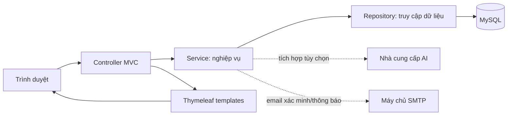

# Kiến trúc SmartEnvelope

## Công nghệ

- Java 17, Spring Boot 4.1.2, Maven.
- Spring MVC, Thymeleaf, Spring Security, Spring Data JPA, Hibernate.
- MySQL và Flyway để tạo/cập nhật cấu trúc dữ liệu.
- AI và SMTP là tích hợp tùy chọn, cấu hình qua biến môi trường.

## Luồng xử lý

## Vị trí mã nguồn

| Thư mục | Vai trò |
|---|---|
| `src/main/java/com/smartenvelope/controller` | Nhận request, kiểm tra quyền, chuẩn bị dữ liệu cho trang |
| `src/main/java/com/smartenvelope/service` | Nghiệp vụ và điều phối giao dịch |
| `src/main/java/com/smartenvelope/repository` | Truy vấn cơ sở dữ liệu |
| `src/main/java/com/smartenvelope/entity` | Entity ánh xạ bảng dữ liệu |
| `src/main/java/com/smartenvelope/dto` | Dữ liệu request/response và form |
| `src/main/java/com/smartenvelope/config` | Cấu hình Spring và bảo mật |
| `src/main/resources/templates` | Trang Thymeleaf |
| `src/main/resources/static` | CSS, JavaScript, hình ảnh |
| `src/main/resources/db/migration` | Migration Flyway, theo thứ tự phiên bản |

## Quy ước khi sửa

1. Đọc controller để hiểu URL và dữ liệu của trang.
2. Theo lời gọi vào service để hiểu quy tắc nghiệp vụ.
3. Đọc repository/entity để biết dữ liệu được lưu và truy vấn ra sao.
4. Đọc template/static để nối nghiệp vụ với giao diện.
5. Thay đổi schema bằng migration Flyway mới; không sửa migration đã được áp dụng ở máy khác.
6. Các nghiệp vụ cập nhật nhiều bảng cần chạy trong transaction service (`@Transactional`).

Xem phân công và đường đọc code theo thành viên tại [PHAN_CONG.md](PHAN_CONG.md), cấu trúc bảng tại [DATABASE.md](DATABASE.md).
