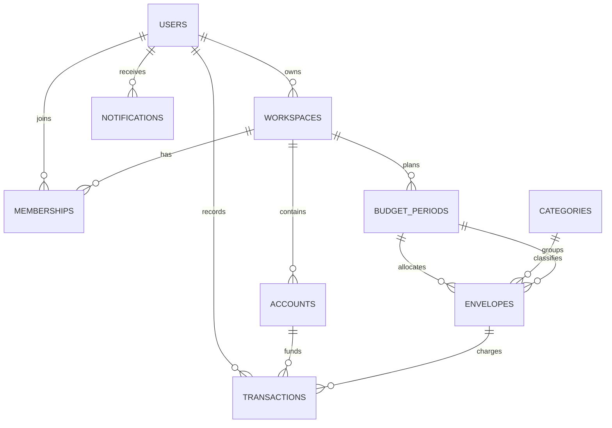

# Cơ sở dữ liệu

## Kết nối

Ứng dụng đọc cấu hình MySQL từ `.env` khi khởi động bằng `run.ps1`, `run.bat` hoặc cấu hình chạy VS Code. Tên biến và giá trị mẫu nằm trong [.env.example](../.env.example). Tạo database rỗng `smart_envelope` trước lần chạy đầu; Flyway sẽ tạo bảng và cập nhật các phiên bản migration.

## Migration

Các migration đang có ở `src/main/resources/db/migration/`:

| Phiên bản | Phạm vi |
|---|---|
| V1 | Người dùng, workspace, thành viên, danh mục |
| V2 | Tài khoản, kỳ ngân sách, phong bì |
| V3 | Giao dịch, chuyển giữa phong bì, nhật ký giao dịch |
| V4 | Cài đặt tài chính, mục tiêu tiết kiệm, heo đất, chốt tháng, thông báo |
| V5 | Danh mục mặc định |
| V6 | Lời mời workspace |
| V7 | Trạng thái hoạt động của danh mục |
| V8 | Ngày lương và giờ nhắc |
| V9 | Khóa phong bì và dữ liệu ước tính giờ lao động |
| V10 | Danh mục chi tiêu khác |
| V11 | Trạng thái xác minh email nhận thông báo |

Không đổi nội dung migration đã áp dụng ở một database dùng chung. Tạo file migration phiên bản tiếp theo, ví dụ `V12__describe_change.sql`.

## Các nhóm bảng

- Danh tính và không gian làm việc: `users`, `workspaces`, `memberships`, `workspace_invitations`.
- Lập ngân sách: `categories`, `accounts`, `budget_periods`, `envelopes`.
- Dòng tiền: `transactions`, `envelope_transfers`, `transaction_audits`.
- Tiết kiệm và nhắc nhở: `user_finance_settings`, `savings_goals`, `piggy_banks`, `piggy_bank_entries`, `month_closes`, `notifications`.
- `flyway_schema_history` do Flyway tự quản lý.

## Quan hệ chính

Đây là sơ đồ khái quát các quan hệ nghiệp vụ; migration và entity là nguồn chính xác cho cột, ràng buộc và quan hệ còn lại.

## Xem dữ liệu và reset để thử nghiệm

Chọn schema `smart_envelope` trong MySQL Workbench rồi xem bảng/query. Để xóa dữ liệu thử nghiệm, dùng thao tác reset phù hợp trong Workbench hoặc xóa các hàng theo thứ tự khóa ngoại. Không xóa database/schema nếu chỉ cần làm sạch dữ liệu. Sao lưu trước khi thao tác với dữ liệu cần giữ.
